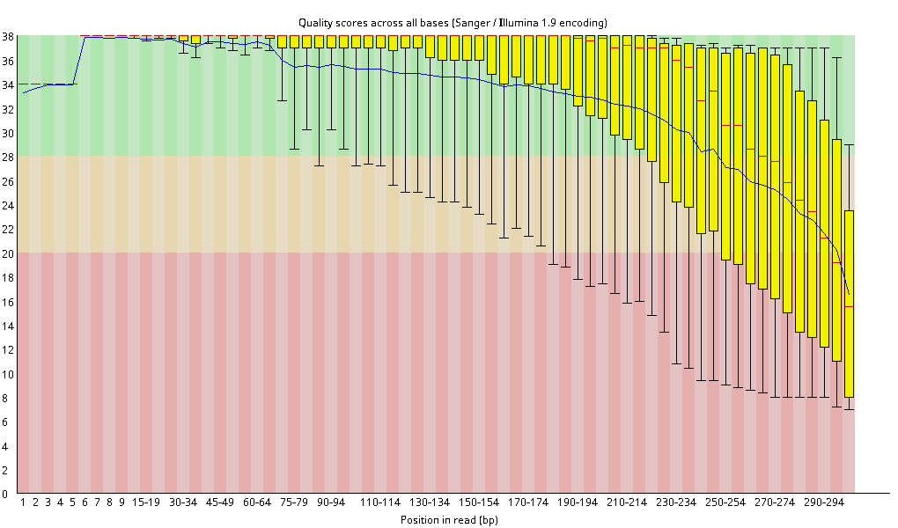
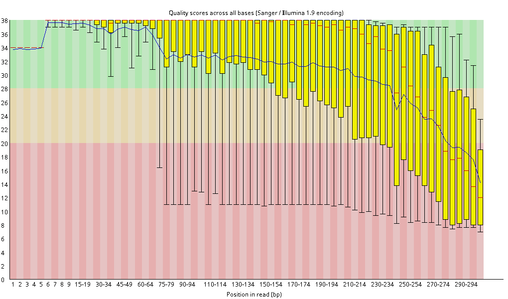
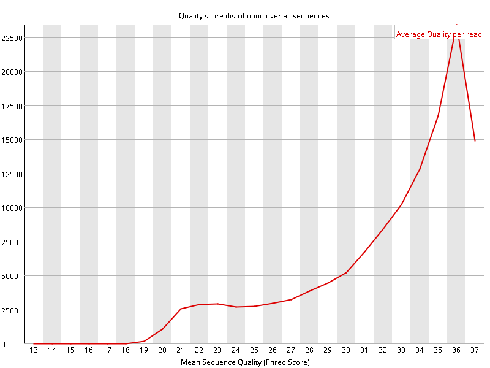
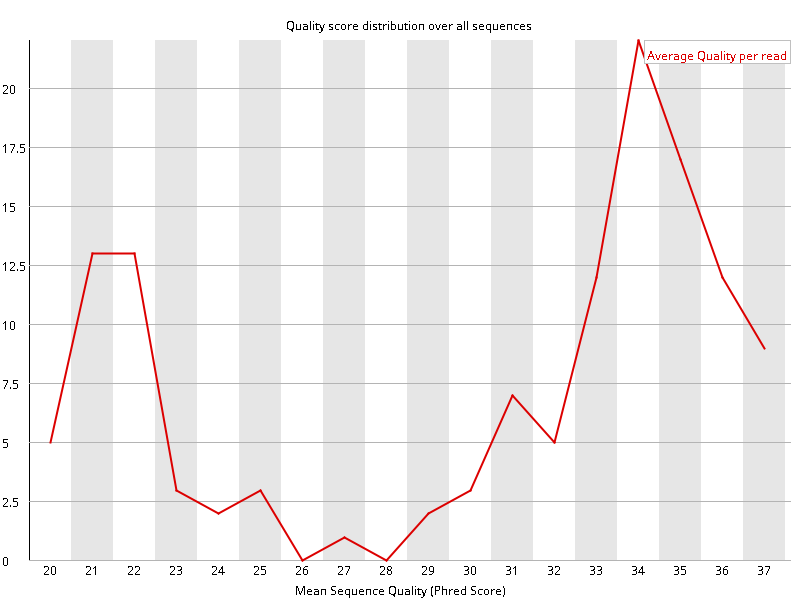
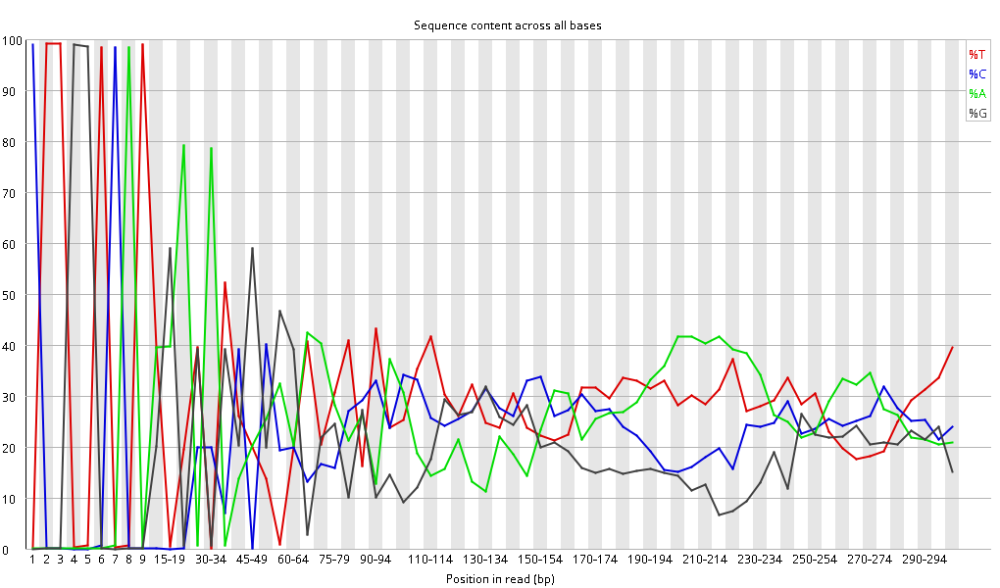
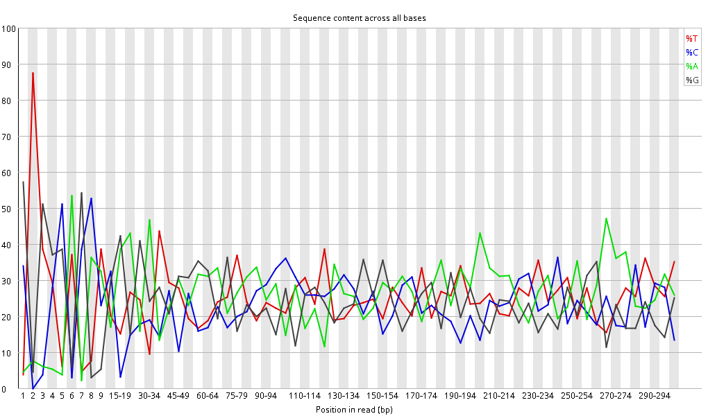

::: callout-warning
## Draft note (remove before publishing)

The first three sections are written out. The planned sections at the end are an outline only. The barcode exercise was run on Crunchomics with the practice data (2026-10-23).

-   `zcat` was tested in Git Bash and MobaXterm (2026-10-22). On a Mac, `gzcat` instead of `zcat` is not tested yet.
:::

This page is for those who want to understand their data better, or who found a flag on the previous page and want to know more. It uses the practice data, which comes from a run where about 40% of the samples failed.

## What a fastq file looks like

A fastq.gz file is compressed, so `head` on it shows unreadable characters. `zcat` unpacks the file and prints the text to the screen, without changing the file itself. Send its output into `head` to see only the start.

On a Mac, use `gzcat` instead of `zcat`, here and in the rest of this page.

```{bash}
# Show the first 4 lines of one fastq file: this is the first read
zcat data/Run1_S137_R1.fastq.gz | head -4
```

Every read takes up 4 lines:

1.  The read name, or header. It starts with `@` and holds information about the sequencing machine and the run. The next section explains its parts.
2.  The sequence: the bases A, C, G and T.
3.  A `+`.
4.  The quality: one character per base. Each character stands for how sure the machine is about that base.

Because every read has 4 lines, you can count the reads in a file. Count the lines and divide by 4:

```{bash}
# Count the lines in one fastq file. Expected: 9940, so 9940 / 4 = 2485 reads
zcat data/Run1_S137_R1.fastq.gz | wc -l
```

On the main page, `seqkit` does this count for all files at once.

More: [zcat](https://ndombrowski.github.io/cli_workshop/source/bash_intro.html#zcat-decompress-and-print-to-screen) and [fastq files](https://ndombrowski.github.io/cli_workshop/source/bash_intro.html#exploring-the-content-of-compressed-fastq-files) in the CLI workshop

## What the read header tells you

Every read in a fastq file starts with a header line that begins with `@`. For Illumina data, the header holds information about where and how the read was sequenced.

```{bash}
# The first header line of one practice file
zcat data/Run1_S137_R1.fastq.gz | head -1
```

It looks something like this:

```         
@M08325:104:000000000-LT57L:1:1101:15589:1335 1:N:0:GTGTATGCGT
```

The parts before the space are separated by `:`:

| Part | Example | Meaning |
|------------------|---------------------------|---------------------------|
| Instrument | `M08325` | The sequencer. An ID starting with `M` is a MiSeq |
| Run number | `104` | The how-manyth run on this instrument |
| Flow cell | `000000000-LT57L` | The flow cell (the glass slide the DNA was sequenced on) |
| Lane | `1` | The lane on the flow cell |
| Tile, x, y | `1101:15589:1335` | Where on the flow cell this read was |

The parts after the space:

| Part     | Example      | Meaning                                     |
|----------|--------------|---------------------------------------------|
| Read     | `1`          | 1 for the R1 file, 2 for the R2 file        |
| Filtered | `N`          | `N`: the read passed the quality filter     |
| Control  | `0`          | 0 for normal reads                          |
| Index    | `GTGTATGCGT` | The barcode as it was read by the sequencer |

**Exercise:** Look at the first header of a `Run1_` and a `Run2_` file. Were they sequenced on the same instrument? In the same run?

**Exercise:** The index at the end is the barcode that was used to sort the read into its sample. Count the indices in the first 1000 reads of a good sample and of a failed sample:

```{bash}
# Count the barcodes in the first 1000 reads (4000 lines) of one file, most common first
# A good sample: how many reads carry the most common barcode?
zcat data/Run1_S137_R1.fastq.gz | head -4000 | awk 'NR % 4 == 1' | cut -d':' -f10 | sort | uniq -c | sort -rn | head

# A failed sample: compare with the good sample
zcat data/Run1_S158_R1.fastq.gz | head -4000 | awk 'NR % 4 == 1' | cut -d':' -f10 | sort | uniq -c | sort -rn | head
```

What do you notice?

::: {.callout-answer .callout-warning collapse="true" title="Practice data: compare with your result"}
Good sample, `Run1_S137`:

```
    919 ACGTATCATC
     18 CCGTATCATC
     10 TCGTATCATC
      8 ACGTAGCATC
      5 ACGTATCACC
      4 GCGTATCATC
      4 ACGTATCATT
      4 ACGTATCATA
      4 ACGTAACATC
      3 ACTTATCATC
```

Failed sample, `Run1_S158`:

```
      4 TGATGTATGT
      2 TGGTGTATGT
      1 TTATGTATGT
      1 TGTTGTATGT
      1 TGATGTAAGT
      1 GGATGTATGT
```

**Good sample:** 919 of the 1000 reads carry the same barcode, `ACGTATCATC`. The other barcodes differ from it in one letter. In these reads, the sequencer misread one base of the barcode. The software that sorts the reads into samples allows for small reading errors like this, so these reads still end up in the right sample.

**Failed sample:** the file has only 10 reads, so the command shows all of them. Only 4 of the 10 reads carry the most common barcode, `TGATGTATGT`. The other 6 each differ from it in one letter.

So in the good sample, more than 9 in 10 reads carry the exact barcode. In the failed sample, fewer than half do. When a sample has almost no reads of its own, the reads with a misread barcode make up a much larger part of the few reads it has.

To check which barcode belongs to which sample, look at the sample sheet from the sequencing center.
:::

## A good and a failed sample in FastQC

This section compares the FastQC report of a good sample, S2, with a failed sample, S91.

The plots below come from the full sequencing data, not from the practice data. The practice data has far fewer reads per sample. With fewer reads, each point in a plot is based on less data, so your FastQC plots of the practice data look noisier: the lines are more jagged and the boxes jump around more. Look at the overall pattern, not at single points. Your own data will likely have more reads and look closer to the plots on this page.

FastQC gives every panel a green tick, an orange exclamation mark or a red cross. Its limits were made for random pieces of DNA, for example from whole genome sequencing. Amplicon reads are not random: they are copies of one short DNA region. So with amplicon data, a good sample also gets several red crosses. Here, the good and the failed sample both get a red cross on 7 of the 11 panels. Don't count red crosses. Instead, compare a good and a suspicious sample side by side, as below.

### Per base sequence quality

{width="700"}

{width="700"}

This plot shows the quality along the read, from the first base (left) to the last base (right). The quality score (y-axis) says how sure the sequencer is about a base. A score of 30 means 1 wrong base in 1,000. A score of 20 means 1 wrong base in 100. The background shows how FastQC rates the scores: green is very good, orange is reasonable, red is poor.

At each position:

-   The yellow box holds the middle half of the reads.
-   The red line in the box is the median.
-   The whiskers (thin lines) show where the lowest 10% and the highest 10% of the reads start.
-   The blue line connects the mean scores.

**Good sample:** the boxes stay at the top up to about base 200. After that, the quality falls, and the last bases end in the red zone. This is normal for long reads, because the sequencing chemistry wears out as the read gets longer. Later analysis steps cut off these low-quality ends. FastQC still gives a red cross.

**Failed sample:** the quality falls much earlier. At about base 70, the mean drops, and the lower whiskers already reach the red zone. The boxes are also wider along the whole read. So the reads in this sample have lower quality overall, not only at the end.

**What to look at:** where the quality starts to fall, not the color at the end of the read.

### Per sequence quality scores

{width="700"}

{width="700"}

This plot gives each read one number: its mean quality over all its bases. The x-axis shows the mean quality, and the y-axis shows how many reads have it.

**Good sample:** one tall peak at a quality of about 36. There is a small bump at 21 to 23: a few reads with low quality. Every run has some of these, so this is normal.

**Failed sample:** two peaks. One is at 34, and a second one is at 21 to 22. About a quarter of the reads have a low quality.

FastQC gives both samples a green tick, because it only checks where the highest peak is. Still, this plot shows the difference between the samples most clearly.

**What to look at:** one peak at high quality is good. A second peak at low quality means that a large part of the reads is poor.

### Per base sequence content

{width="700"}

{width="700"}

This plot shows, for each position in the read, how many percent of the reads have an A, C, G or T. In random DNA, the four lines would run flat and close together. Amplicon reads are different. They all start with the same primer, and they come from a small number of organisms.

**Good sample:** in the first 9 positions, one base reaches almost 100% at each position. Read the peaks from left to right: C, T, T, G, G, T, C, A, T. This is the start of the ITS1F primer, `CTTGGTCATTTAGAGGAAGTAA`. After the primer, the lines go up and down, because most reads come from a few organisms. FastQC gives a red cross, but for amplicon data this is expected.

**Failed sample:** the primer is not clearly visible. At position 1, about 57% of the reads have a G and about 34% have a C. The C fits the ITS1F primer (`CTT...`). The G fits the 16S primer 515F (`GTG...`). So this ITS sample also holds 16S reads, probably from other samples on the same run.

**What to look at:** in amplicon data, the first bases of the reads should spell out your primer. If they don't, the sample holds reads that don't belong there.

More: [FastQC help, one page per panel](https://www.bioinformatics.babraham.ac.uk/projects/fastqc/Help/3%20Analysis%20Modules/)

## Planned sections

-   **Why failed samples look low quality**: their few reads mostly come from other samples, through barcodes that were misread by one letter. Such reads tend to have lower quality overall.
-   **From sample numbers to plate positions**: how sample numbers map onto a 96-well plate, and how to see that the failed samples sit in the same columns on every plate.
-   **Comparing two runs**: run IDs per file, and why read numbers should be compared within a run.
-   **What to ask the sequencing center**: the Undetermined reads, cluster numbers, and the demultiplexing report.