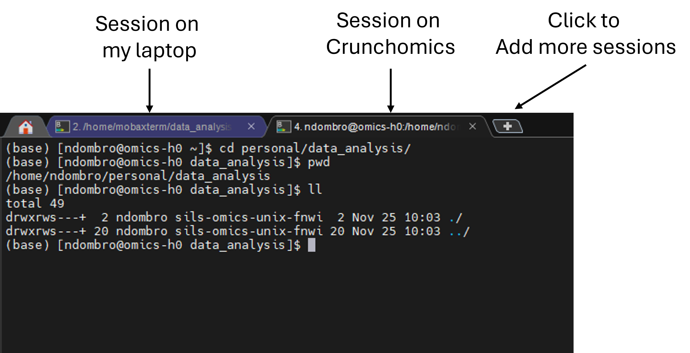
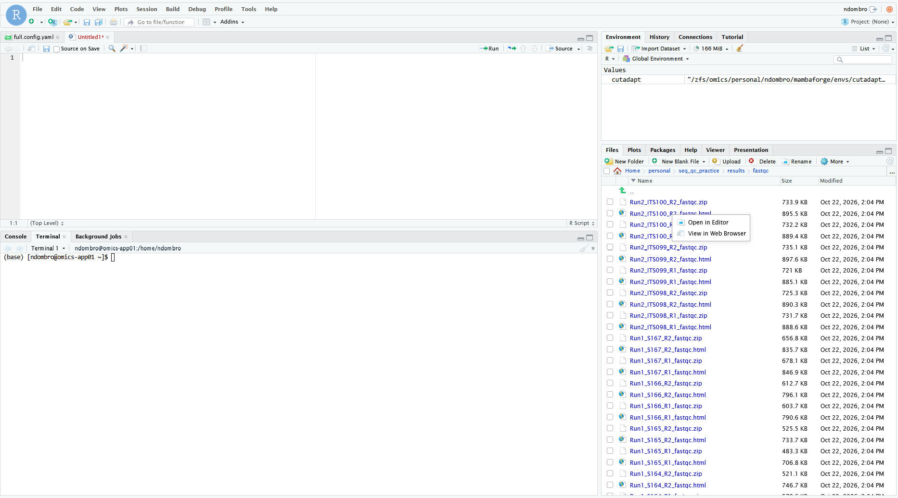

On this page, you copy data to Crunchomics, count the reads in every sample, make a quality report, and decide whether something looks off.

You do this first with the practice data from [The commands you need](cli_minimum.qmd). Then, if you already have your own sequencing data, you can repeat the same steps with your own data, as explained in [Now your own data](#now-your-own-data).

Two kinds of boxes on this page are closed. Open them only when you need them:

- **☑️ Practice data: compare with your result.** First look at what your terminal printed. Then open the box and compare.
- **🧰 If something went wrong.** Open this box only if a check gives a different result than expected.

**Keep notes as you go.** Copy each command you run into a text file, with a few words about what you saw. The [CLI workshop](https://ndombrowski.github.io/cli_workshop/source/bash_intro.html#touch-starting-your-notebook) explains how. If something looks off and you ask someone for help later, these notes help a lot.

## Step 1: Log in and make a practice folder

Crunchomics is the **High Performance Computer (HPC)** of the UvA: a group of powerful computers that you use through the terminal. Your sequencing files are large, and the tools you need are already installed there. With `ssh`, you connect your terminal to Crunchomics. After that, every command you type runs on Crunchomics, not on your own computer, until you log out.

```{bash}
# On your computer: log in to Crunchomics (on eduroam or with the VPN)
# Replace uvanetid with your own UvAnetID
# You won't see anything happening when you type your password, that is normal
ssh uvanetid@omics-h0.science.uva.nl
```

If `ssh` asks whether you want to continue connecting, type `yes` and press Enter. After you log in, the prompt changes: it now shows your UvAnetID and `omics-h0`. This is how you know that your commands run on Crunchomics. To log out, type `exit`. More: [ssh in the CLI workshop](https://ndombrowski.github.io/cli_workshop/source/hpc_howto.html#ssh-connecting-to-a-server).

**If this is your first time on Crunchomics**, set up your account once. A script adds the installed software to your PATH (the list of folders where bash looks for programs) and makes the `personal` folder that you use below. Skip this if you did it before, for example in the CLI workshop.

```{bash}
# On Crunchomics: run the setup script (only once per account)
/zfs/omics/software/script/omics_install_script

# Check: you should now see a line that ends with personal -> /zfs/omics/personal/uvanetid
ls -lh
```

More: [preparing your account in the CLI workshop](https://ndombrowski.github.io/cli_workshop/source/hpc_howto.html#crunchomics-preparing-your-account).

Now make a practice folder in your personal folder, with a `data` folder for the sequencing files and a `results` folder for everything you make:

```{bash}
# On Crunchomics: go to your personal folder
# It has 500 GB of space, your home folder only 25 GB, so keep your data here
cd ~/personal

# Make the practice folder with a data and a results folder inside
# The -p also makes seq_qc_practice if it does not exist yet, and gives no error if it already exists
mkdir -p seq_qc_practice/data seq_qc_practice/results

# Move into the practice folder
cd seq_qc_practice

# Check: you should be in /home/uvanetid/personal/seq_qc_practice (with your UvAnetID), and see data and results
pwd
ls
```

::: {.callout-fix .callout-caution collapse="true" title="cd: personal: No such file or directory"}
Your account is not set up yet, so the `personal` folder does not exist. Run the setup script above, then try `cd ~/personal` again.
:::


**From now on, run every command on Crunchomics from inside the `seq_qc_practice` folder.** If you log out and in again, first go back with `cd ~/personal/seq_qc_practice`.

## Step 2: Copy the practice data to Crunchomics

You copy `practice_data.tar.gz` from your own computer to Crunchomics with `scp`. This is the same command you can use later for your own data.

You must run `scp` in a terminal on **your own computer**, because that is where the file is. So open a **second terminal on your own computer**, and keep the first one logged in to Crunchomics:

- **MobaXterm (Windows):** click the **+** next to your open tab. A new tab opens on your own computer.
- **WSL (Windows):** click the **+** at the top of the Ubuntu window. If the new tab opens PowerShell instead of Ubuntu, click the small arrow next to the **+** and choose **Ubuntu**.
- **Mac:** in Terminal, press Command-N.

{width=700}

In the second terminal:

```{bash}
# On your computer: go to the practice folder in your home folder
cd ~/seq_qc_practice

# Copy the practice data into the practice folder on Crunchomics
# Replace both instances of uvanetid with your UvAnetID
scp practice_data.tar.gz uvanetid@omics-h0.science.uva.nl:/home/uvanetid/personal/seq_qc_practice/
```

An `scp` command has two parts: first what you copy (the source), then where it goes (the destination). Here, the source is `practice_data.tar.gz` in the folder you are in. The destination is your practice folder on Crunchomics. Before the `:` is your login, as with `ssh`, and after the `:` is the path on Crunchomics. `scp` asks for your password again, and again you do not see anything while you type. More: [scp in the CLI workshop](https://ndombrowski.github.io/cli_workshop/source/hpc_howto.html#scp-transferring-data-to-and-from-a-server).

::: {.callout-tip title="Tip: Download the practice data directly onto Crunchomics (optional)" collapse="true"}
If you did not download the practice data on your own computer, download it directly onto Crunchomics instead:

```{bash}
# On Crunchomics, inside seq_qc_practice: download the practice data
curl -L -O "https://raw.githubusercontent.com/ndombrowski/sequencing_qc/main/data/practice_data.tar.gz"
```
:::

Now go back to the terminal that is logged in to Crunchomics, and unpack the file:

```{bash}
# On Crunchomics, inside seq_qc_practice
# Check: is practice_data.tar.gz there, and how large is it?
ls -lh

# Unpack it: -x extract, -z it is compressed (.gz), -f the file name follows
tar -xzf practice_data.tar.gz

# Check: which files and folders do you see now?
ls -lh
```

::: {.callout-answer .callout-warning collapse="true" title="Practice data: compare with your result"}
- Before unpacking: `practice_data.tar.gz`, with a size of about 11M (11 megabytes), and the empty `data` and `results` folders.
- After unpacking: `data`, `results`, `practice_data.tar.gz` and `seqkit_stats_practice.tsv`.
:::

The practice data has two parts:

- A small set of fastq files in `data`, in one folder per sample (32 samples, each reduced to 2% of its reads). You use them to try the tools in Steps 3 and 5.
- `seqkit_stats_practice.tsv`: the full read-count table of the original runs (364 samples). You use it for the read-count check in Step 4.

### Move the files out of the sample folders

All commands on this page expect the fastq.gz files directly in `data`, for example `data/*.fastq.gz`. As on your own computer, move the fastq.gz files directly into `data` and remove the empty sample folders. See [Tidy up: mv and rmdir](cli_minimum.qmd#tidy-up-mv-and-rmdir) if you need a reminder.

```{bash}
# On Crunchomics, inside seq_qc_practice
# Count the fastq.gz files in the sample folders
ls data/*/*.fastq.gz | wc -l

# Move them up into the data folder. -n: never overwrite a file that already exists
mv -n data/*/*.fastq.gz data/

# Count the fastq.gz files directly in data: the same number as before
ls data/*.fastq.gz | wc -l

# Remove the empty sample folders. rmdir only removes empty folders
rmdir data/*/

# Check: data should now contain only fastq.gz files
ls data | head
ls data | wc -l
```

::: {.callout-answer .callout-warning collapse="true" title="Practice data: compare with your result"}
- 64 fastq.gz files in the sample folders, and 64 directly in `data` after `mv`.
- After `rmdir`, `ls data | wc -l` also gives 64: no folders are left.
:::

### Check: are all files there?

The fastq.gz files should sit directly in the `data` folder. With paired-end sequencing, each sample has one R1 and one R2 file.

```{bash}
# On Crunchomics, inside seq_qc_practice
# Look at the first file names
ls data | head

# Count all fastq.gz files
ls data/*.fastq.gz | wc -l

# Count the R1 and the R2 files: these numbers should be the same
# The second * also finds names with more text after R1, for example Sample1_R1_001.fastq.gz
ls data/*_R1*.fastq.gz | wc -l
ls data/*_R2*.fastq.gz | wc -l
```

::: {.callout-answer .callout-warning collapse="true" title="Practice data: compare with your result"}
64 fastq.gz files: 32 R1 files and 32 R2 files. So the practice data has 32 samples.
:::

## Step 3: Count reads with seqkit

`seqkit stats` makes one table with the number of reads and their quality for every file. It is installed on Crunchomics. The [CLI workshop](https://ndombrowski.github.io/cli_workshop/source/hpc_howto.html#run-seqkit-stats-with-srun) explains the options in detail.

Before you run this software, you need to know how Crunchomics works, because it has two kinds of computers. When you log in, you are on the **login node**. Everyone shares it, so use it only for small tasks, like moving around and looking at files. As a rule of thumb, a task that needs only one CPU and finishes in less than an hour can run on the login node. Heavier work, like counting all reads, runs on a **compute node**. The command `srun` sends your command to such a compute node. The options after `srun` say how much the command may use: the number of CPUs (processors that work at the same time), the memory, and the maximum time. The tools you run here are not very heavy and you can typically use the exact same settings for your own data.

More: [login node and compute nodes](https://ndombrowski.github.io/cli_workshop/source/hpc_howto.html#login-node-and-compute-nodes) and [srun](https://ndombrowski.github.io/cli_workshop/source/hpc_howto.html#srun-submitting-a-job-interactively) in the CLI workshop.

::: {.callout-important title="Important: keep the terminal open until the prompt comes back" collapse="false"}
`srun` waits until the command is done. If you close the terminal, lose the connection, or your laptop goes to sleep, the command stops halfway. With the practice data, this takes a few minutes. Keep the terminal open and your laptop awake until you see the prompt again.
:::

```{bash}
# On Crunchomics, inside seq_qc_practice
mkdir -p results/seqkit

# Run seqkit stats on a compute node, with 4 CPUs
# -j 4: seqkit uses the 4 CPUs that srun asks for
# The \ at the end of the first line means: the command continues on the next line.
# Copy both lines together.
# While the command runs, you see nothing. Wait until the prompt comes back.
srun --cpus-per-task=4 --mem=8G --time=01:00:00 \
    seqkit stats -b -a -T -j 4 -o results/seqkit/seqkit_stats.tsv data/*.fastq.gz

# Check: one header line plus one line per fastq.gz file
wc -l results/seqkit/seqkit_stats.tsv

# Look at the table. Use the arrow keys to scroll, and q to quit
column -t results/seqkit/seqkit_stats.tsv | less -S
```

If you type the `srun` command yourself, put nothing after the `\`, not even a space.

The most important column for now is `num_seqs`, the number of reads in each file. Scroll through it. Do you see files with far fewer reads than the others?

::: {.callout-answer .callout-warning collapse="true" title="Practice data: compare with your result"}
65 lines: one header line and 64 files.

Most `Run1_` samples up to `Run1_S152` have about 1,000 to 2,700 reads. From `Run1_S153` on, the samples have between 0 and 18 reads, and `Run1_S154` has none at all. The three `Run2_` samples have about 550 reads each.
:::

These numbers are small because every file was reduced to 2% of its reads. With these reduced files, almost every sample would fall below the 1,000-read flag in Step 4. That is why you use the full practice table in Step 4.

## Step 4: The read-count check

This is the most important step. You look for samples with far fewer reads than the rest.

In this step, you use the full practice table, `seqkit_stats_practice.tsv`, with all 364 samples of the original runs.

### 4a: R1 and R2 have the same number of reads

For paired-end data, every read in the R1 file has a partner in the R2 file. So both files of a sample must have the same number of reads.

```{bash}
# On Crunchomics, inside seq_qc_practice
# Make two files that store the read numbers of all R1 files, and of all R2 files, in the same order
grep "_R1" seqkit_stats_practice.tsv | cut -f4 > results/seqkit/r1_counts.txt
grep "_R2" seqkit_stats_practice.tsv | cut -f4 > results/seqkit/r2_counts.txt

# Put them side by side and count the lines where they differ. Expected: 0
paste results/seqkit/r1_counts.txt results/seqkit/r2_counts.txt | awk '$1 != $2' | wc -l
```

::: {.callout-answer .callout-warning collapse="true" title="Practice data: compare with your result"}
0: R1 and R2 have the same number of reads in every sample.
:::

::: {.callout-fix .callout-caution collapse="true" title="If the result is not 0: what to check"}
First check in [Step 2](#check-are-all-files-there) that the numbers of R1 and R2 files are the same. The command above compares the files line by line. If one R1 or R2 file is missing, every line after it is shifted, and many lines differ.

Some files may also be incomplete. This often happens when a download or a copy breaks off halfway. Test whether the files are complete:

```{bash}
# On Crunchomics, inside seq_qc_practice
# This uses one CPU, so it can run on the login node, without srun
# Test every fastq.gz file. gzip -t prints nothing if a file is complete,
# and an error message (for example "unexpected end of file") if it is not 
# If all is good then you only see the name of the fastq.gz files on the screen
for f in data/*.fastq.gz; do
    echo "$f"
    gzip -t "$f"
done
```

Download or copy the broken files again, and run Steps 3 and 4 again. If the new files are still broken, contact the sequencing center. Also contact the sequencing center if all files are complete and the read numbers of R1 and R2 still differ.
:::

### 4b: Reads per sample, from low to high

Next, you make a new file that only stores the number of reads per file, to make some comparisons. For this, you only use the R1 files, so that each sample is counted once.

```{bash}
# Take the file name (column 1) and the number of reads (column 4) of all R1 files,
# and sort from the lowest to the highest number of reads
cut -f1,4 seqkit_stats_practice.tsv | grep "_R1" | sort -t$'\t' -k2,2n > results/read_counts.tsv

# Check: one line per sample
wc -l results/read_counts.tsv

# The 10 samples with the fewest reads, and the 5 with the most
head results/read_counts.tsv
tail -5 results/read_counts.tsv
```

::: {.callout-answer .callout-warning collapse="true" title="Practice data: compare with your result"}
364 lines, one per sample. The samples with the fewest reads have only 10 to 40 reads. The samples with the most reads have more than 150,000.
:::

### 4c: Which samples have very few reads?

A sample is flagged if it has **fewer than 1,000 reads**, or **fewer than 10% of the median** number of reads. You check the two flags one after the other.

First, you store the name of the file to check in a **variable**. A variable stores a piece of text under a short name. `$counts` then stands for that text. If you later want to check another file, for example one sequencing run on its own (see 4f), you only change this one line. More: [variables in the CLI workshop](https://ndombrowski.github.io/cli_workshop/source/bash_intro.html#echo-and-variables-storing-information).

Variables are lost when you log out or close the terminal. If you continue later, first run the commands of 4c again. Without them, the commands below give wrong results without an error: they print 0 or nothing, or they seem to hang. If a command seems to hang, press Ctrl+C to stop it.

Start with the first flag:

```{bash}
# The read-count file to check: all samples, sorted from low to high
counts=results/read_counts.tsv

# Flag 1: how many samples have fewer than 1000 reads?
# -F'\t': the columns are separated by tabs. '$2 < 1000': keep lines where column 2 is below 1000
awk -F'\t' '$2 < 1000' "$counts" | wc -l
```

::: {.callout-answer .callout-warning collapse="true" title="Practice data: compare with your result"}
104 samples have fewer than 1,000 reads.
:::

A fixed number does not fit every dataset. If the median is 200,000 reads, a sample with 5,000 reads has clearly failed, but it still has more than 1,000 reads. So you also compare each sample with the **median**. The median is the read number of the sample in the middle of the sorted list. Unlike the average, it is not pulled down by a few failed samples.

```{bash}
# The median: the read number on the middle line of the sorted file
n_samples=$(wc -l < "$counts")
middle=$(( (n_samples + 1) / 2 ))
median=$(sed -n "${middle}p" "$counts" | cut -f2)

# The limit: 10% of the median
limit=$(( median / 10 ))
echo "samples: $n_samples  median: $median  10% of median: $limit"

# Flag 2: how many samples have fewer reads than 10% of the median?
awk -F'\t' -v limit="$limit" '$2 < limit' "$counts" | wc -l
```

::: {.callout-answer .callout-warning collapse="true" title="Practice data: compare with your result"}
364 samples, a median of 30,149 reads and a limit of 3,014. 108 samples fall below the limit: the 104 samples from flag 1, plus 4 samples with between 1,000 and 3,014 reads.
:::

### 4d: Do the flagged samples form a pattern?

A few scattered samples with low reads are normal: some samples simply contain little DNA. You do not need to contact anyone about them. Still, write them down. Later, in your analysis, you decide what to do with them, for example remove them, or keep them and check whether they change your results. A **block** of samples with consecutive numbers is a warning sign. It points to a problem with a group of samples that were handled together, for example one part of a plate.

```{bash}
# The flagged samples, sorted by name instead of by reads
# sort -V sorts numbers in names the way people do (S9 before S10)
awk -F'\t' -v limit="$limit" '$2 < limit' "$counts" | sort -V | column -t
```

::: {.callout-answer .callout-warning collapse="true" title="Practice data: compare with your result"}
In run 1, the flagged samples form clear blocks: `Run1_S057` to `Run1_S095`, `Run1_S153` to `Run1_S191` and `Run1_S249` to `Run1_S280`. The samples were on three 96-well plates, and on every plate, columns 8 to 12 failed. **This is a clear reason to go through the checklist in [Step 6](#step-6-decide).**

In run 2, 6 samples are flagged. Three are blanks, which is expected (see 4e). The other three (`Run2_ITS097`, `Run2_ITS175`, `Run2_ITS178`) are scattered, with about 1,000 to 2,500 reads. That is worth a note for your analysis, but not alarming.
:::

### 4e: Blanks and controls

Blanks (negative controls) should have clearly fewer reads than your samples. The command looks for common names for controls:

```{bash}
# Lines with blank, neg, ntc, control or mock in the name (upper or lower case)
grep -i -E "blank|neg|ntc|control|mock" "$counts"
```

A blank with as many reads as a normal sample can mean contamination. A positive control (for example a mock community) with very few reads can mean that the PCR did not work well.

::: {.callout-answer .callout-warning collapse="true" title="Practice data: compare with your result"}
5 lines, all from run 2. Run 1 of the practice data has no controls.

- Three blanks have few reads (41, 126 and 237), as expected.
- One blank, `Run2_ITS191_PCR_Blank`, has 4,561 reads, which is high for a blank. Worth mentioning.
- `Run2_ITS192_PCR_Control` has 30,798 reads, close to the median. If this is a positive control, that is a good sign.
:::

### 4f: More than one sequencing run? (optional)

Sequencing runs can differ a lot in how many reads they give. If your data comes from more than one run, the median of all samples together may not fit each run.

::: {.callout-tip title="Tip: Check each sequencing run on its own (optional)" collapse="true"}
The practice table contains two runs. The file names start with the run (`Run1_` or `Run2_`), so you can split the table by name. For your own data, see [Now your own data](#repeat-steps-3-to-6) to find out which run each file comes from.

```{bash}
# One read-count file per run
# The ^ means "at the start of the line"
grep "^Run1_" results/read_counts.tsv > results/read_counts_run1.tsv
grep "^Run2_" results/read_counts.tsv > results/read_counts_run2.tsv

# Check: the number of samples per run
wc -l results/read_counts_run1.tsv results/read_counts_run2.tsv
```

Then set `counts` to one run, and run the commands of 4c, 4d and 4e again. Repeat for the other run:

```{bash}
# Check run 1 on its own
counts=results/read_counts_run1.tsv

# After 4c to 4e for run 1: check run 2 on its own
counts=results/read_counts_run2.tsv
```

::: {.callout-answer .callout-warning collapse="true" title="Practice data: compare with your result"}
- Run 1: 240 samples, a median of 95,605 reads and a limit of 9,560. 102 samples fall below the limit.
- Run 2: 124 samples, a median of 29,236 reads and a limit of 2,923. 6 samples fall below the limit.

The two medians differ by a factor of three. Still, the flagged samples are the same 108 as in 4c, because the failed samples have far fewer reads than any of the limits. With other data, a run can have samples that pass the limit of all samples together, but fall below the limit of their own run. This is most likely when one run gives many more reads than the other.
:::
:::

## Step 5: Quality reports with FastQC

FastQC makes a quality report for every fastq file. You open a few of these reports in your browser (5b) and look for samples that stand out (5c). If you have many samples, you can also combine all reports into one with MultiQC (5d, optional).

### 5a: FastQC

FastQC is installed on Crunchomics. As in Step 3, keep the terminal open until the prompt comes back.

```{bash}
# On Crunchomics, inside seq_qc_practice
mkdir -p results/fastqc

# Run FastQC on all fastq.gz files, on a compute node with 8 CPUs
# --threads 8: FastQC uses the 8 CPUs that srun asks for. Copy both lines together.
srun --cpus-per-task=8 --mem=16G --time=02:00:00 \
    fastqc data/*.fastq.gz -o results/fastqc --threads 8

# Check: one html report per fastq.gz file, so these two numbers should be the same
ls results/fastqc/*.html | wc -l
ls data/*.fastq.gz | wc -l
```

As a rough guide, about 700 files from a MiSeq amplicon run took about 20 minutes with 10 CPUs. Small runs, like the practice data, finish in a few minutes.

::: {.callout-answer .callout-warning collapse="true" title="Practice data: compare with your result"}
64 html reports and 64 fastq.gz files.
:::

### 5b: Open a few reports

With many samples, you do not need to look at every report. Pick a few that tell you the most:

- **Two or three typical samples**, with a read number close to the median
- **The samples with the fewest reads**, especially if they were flagged in Step 4
- **Your blanks and controls**

For the practice data, compare a good sample, `Run1_S137_R1_fastqc.html`, with a failed one, `Run1_S158_R1_fastqc.html` (10 reads), and with the empty `Run1_S154_R1_fastqc.html`. The FastQC report of a file has the same name as the file, but ends in `_fastqc.html` instead of `.fastq.gz`.

Open a typical sample first, so that you know what "normal" looks like for your data. Then compare the others with it. Choose one of the two ways to open the reports:

::: {.panel-tabset}
#### RStudio in your browser

Crunchomics also runs RStudio, a program that you use in your web browser. Its file browser lets you open the reports with a few clicks, without any commands.

1. In your web browser, go to `omics-app01.science.uva.nl` (on eduroam or with the VPN, as for `ssh`).
2. Sign in with your UvAnetID and your UvA password, the same as for `ssh`.
3. In the **Files** pane at the bottom right, click **personal**, then **seq_qc_practice**, then **results**, then **fastqc**.
4. Click the name of a report that ends in `_fastqc.html`, and choose **View in Web Browser**. The report opens in a new browser tab.

{width=700}

RStudio signs you out after 60 minutes without activity. Then just sign in again.

#### Copy with scp

Copy the reports to your own computer, as in Step 2. Run this in a terminal on **your own computer**, once per report:

```{bash}
# On your computer: go to the practice folder in your home folder
cd ~/seq_qc_practice

# Copy one FastQC report into the current folder. The . at the end means "the current folder"
# Replace both instances of uvanetid with your UvAnetID, and the file name with the report you want
scp uvanetid@omics-h0.science.uva.nl:/home/uvanetid/personal/seq_qc_practice/results/fastqc/Run1_S137_R1_fastqc.html .

# Check: the report is there
ls -lh *.html
```

To open the report, open the current folder in the file browser of your computer. Then double-click the html file, and it opens in your web browser:

```{bash}
# On your computer, inside seq_qc_practice
# Windows (MobaXterm or WSL): open the current folder in File Explorer
explorer.exe .

# Mac: open the current folder in Finder
open .
```

Use the command for your own system. More: [the file browser in the CLI workshop](https://ndombrowski.github.io/cli_workshop/source/bash_intro.html#mkdir-make-new-folders).
:::

### 5c: What to look at in the reports

FastQC and MultiQC mark many things in yellow or red. For amplicon data, much of that is normal. Focus on whether **some samples look clearly different from the rest**.

**Usually normal for amplicon data** (no need to worry):

- *Per base sequence content* fails: all reads start with the same primer, so the first bases are the same in every read
- *Sequence duplication* is high, and *overrepresented sequences* are listed: amplicons are many copies of a few sequences. The overrepresented sequences often start with your primer
- *Per sequence GC content* does not look like a smooth bell curve: the GC content depends on which organisms are in the sample
- Quality goes down towards the end of the reads, more in R2 than in R1. Long reads (for example 2x300 bp on a MiSeq) often end in the yellow or red zone
- Some *adapter content* at the end of the reads, if your amplicon is shorter than the read length

If you want to know what a panel shows, the [FastQC help](https://www.bioinformatics.babraham.ac.uk/projects/fastqc/Help/3%20Analysis%20Modules/) has one page per panel. It is written for all kinds of sequencing data, so a warning there does not always mean a problem for amplicon data (see the list above). The [deeper dive](deeper_dive.qmd#a-good-and-a-failed-sample-in-fastqc) shows a few panels of the practice data.

**Worth a closer look:**

- *Sequence counts*: samples with far fewer reads than the rest (you already checked this in Step 4)
- A group of samples with clearly lower quality than all others
- Reports with *Total Sequences* 0: the file is empty. FastQC still makes a report, but the plots are empty and values like "File type: null" mean nothing
- Quality that is low already at the start of the reads, in many samples

Samples with very few reads often also look worse in the quality plots. That is usually a side effect of having few reads, not a separate problem. The read-count check from Step 4 is the more reliable signal.

### 5d: One report for all samples with MultiQC (optional)

MultiQC combines all FastQC reports into one report. This makes it easier to compare many samples at once. It needs a bit more setup: MultiQC is not installed on Crunchomics for everyone, so you install it yourself with **conda**. Conda is a program that installs software into separate **environments**: folders with one tool and everything it needs, so that tools do not get in each other's way. You only do this once. Afterwards, you can use MultiQC for every new sequencing run.

::: {.callout-tip title="Tip: Install MultiQC (only needed once)" collapse="true"}
1. **Install conda.** Follow the steps in [Install Miniforge](https://ndombrowski.github.io/cli_workshop/source/hpc_howto.html#install-miniforge) in the CLI workshop. If you already use conda on Crunchomics, skip this step.

2. **Make an environment with MultiQC:**

```{bash}
# On Crunchomics: make an environment called multiqc_1.35 and install MultiQC version 1.35 into it
# Press Y and Enter when mamba asks you to confirm
mamba create -n multiqc_1.35 -c conda-forge -c bioconda multiqc=1.35
```

3. **Check that it works:**

```{bash}
# Activate the environment, print the MultiQC version, and leave the environment again
conda activate multiqc_1.35
multiqc --version
conda deactivate
```

This should print the version, 1.35. More about environments: [mamba create in the CLI workshop](https://ndombrowski.github.io/cli_workshop/source/hpc_howto.html#mamba-create-make-an-environment-with-fastp).
:::

Now make the report:

```{bash}
# On Crunchomics, inside seq_qc_practice: make one report from all FastQC reports
# MultiQC uses one CPU and finishes quickly, so it can run on the login node, without srun
mkdir -p results/multiqc
conda activate multiqc_1.35
multiqc results/fastqc -o results/multiqc
conda deactivate

# Check: the folder should contain multiqc_report.html
ls -lh results/multiqc
```

Open `multiqc_report.html` as in 5b: in RStudio, go to **results**, then **multiqc**. Or copy it with `scp`, in a terminal on **your own computer**:

```{bash}
# On your computer: go to the practice folder, and copy the MultiQC report into it
# Replace both instances of uvanetid with your UvAnetID
cd ~/seq_qc_practice
scp uvanetid@omics-h0.science.uva.nl:/home/uvanetid/personal/seq_qc_practice/results/multiqc/multiqc_report.html .
```

## Step 6: Decide

**Also read the delivery report.** Many sequencing centers send a report with the read number per sample, and sometimes a warning about low samples. You do not need the command line for that, and it is easy to miss in a long email.

**If nothing stands out: good news.** Write down the date and the main numbers (number of samples, median reads, number of flagged samples) in your notes, and continue with your analysis.

**If something stands out, act now.** Most problems can still be explained or fixed in the first weeks: the leftover DNA and libraries still exist, and people still remember what they did. Open the box below that matches your problem. Each box says what to check and who to contact.

For the practice data, run 1 clearly has "many samples with few reads, in a block". With your own data, this is where you would start to check your lab records.


::: {.callout-fix .callout-caution collapse="true" title="Files are missing, or the number of R1 and R2 files differs (Step 2)"}
- Compare the file names with your sample sheet. Are the missing samples ones that you sent?
- Download or copy the data again. Downloads can break off without a clear error.
- Some sequencing centers send **checksums** with the data, often in a file ending in `.md5`. A checksum is a short code that is calculated from a file. If the code of your copy matches the code from the center, your copy is complete. Ask Nina if you are unsure how to compare them.

**Who to contact:** the sequencing center.
:::

::: {.callout-fix .callout-caution collapse="true" title="R1 and R2 of a sample have different read numbers (4a)"}
- Test the files and download them again, as explained in the box in 4a.

**Who to contact:** the sequencing center, if the new files are still broken.
:::

::: {.callout-fix .callout-caution collapse="true" title="Many samples have few reads, or they form a block (4c and 4d)"}
Go through your lab records, step by step. For each step, compare the flagged samples with the other samples:

- **DNA extraction:** the DNA concentrations. Were they already low for the flagged samples?
- **PCR:** the gel images. Did the flagged samples show a band?
- **Library preparation and pooling:** the library concentrations, and the volume of each sample that went into the pool.
- **Indexes:** the index (barcode) of each sample, in the sample sheet you sent to the sequencing center. The center uses these indexes to sort the reads into samples. This is called **demultiplexing**. A wrong or swapped index can make a sample look empty.
- **Plate layout:** do the flagged samples share a plate, a row or a column? That points to a step that was done per plate, row or column, for example with a multichannel pipette or an index plate.
- **The delivery report:** how many reads are "undetermined"? These are reads that the center could not assign to any sample. Many undetermined reads can point to a problem with the indexes.

**Who to contact:** the person who did the step that looks off. That can be you, a technician or a student. For questions about indexes and undetermined reads, contact the sequencing center.
:::

::: {.callout-fix .callout-caution collapse="true" title="Blanks have many reads, or a positive control has very few (4e)"}
- The gel images and concentrations of the controls.
- The position of the controls on the plate. Was a blank next to a sample with a lot of DNA?
- Keep the blanks and controls in your data, and write down which ones had reads. They are used later in the analysis to recognize contamination.

**Who to contact:** the person who did the lab work.
:::

::: {.callout-fix .callout-caution collapse="true" title="Some samples have clearly worse quality than the rest (Step 5)"}
- Do the same samples also have few reads (Step 4)? Then the low quality is probably a side effect of the low read number. Follow the box for few reads instead.
- Is the quality only lower towards the end of the reads? This is usually handled later, in your analysis, with a **quality trimming** step. Trimming cuts off the low-quality ends of the reads, and filtering removes reads that are too poor overall. Write down which samples look worse, so you can check them again after trimming.
- Keep in mind that trimming has a limit. In most amplicon analyses, R1 and R2 of each read pair are joined into one sequence later. This only works if the two reads still overlap after trimming. If you have to cut off a lot, they may no longer overlap.
- Is the quality low already at the start of the reads, in many samples? Or does the delivery report mention a problem with the run? Then the problem is probably in the sequencing run itself.

**Who to contact:** the sequencing center, if the quality is low from the start of the reads, or if the delivery report mentions a problem. For a drop towards the end of the reads, you usually do not need to contact anyone.
:::

### What to bring

Whoever you contact, these help them to understand the problem:

- `read_counts.tsv` (copy it to your computer with `scp`, as in Step 5b)
- `multiqc_report.html`, if you made one
- Your sample list, with the plate layout if you have it
- The delivery email from the sequencing center, with any reports that came with it
- Your notes: what you ran and what you saw

### If you are still stuck

Maybe the checks above do not explain the problem. Maybe you do not know who did a step, or something else surprised you. Then talk to your PI. You can also contact Nina. This is especially useful if the samples cannot be sequenced again, and you want to discuss whether the data can still be used.

## Now your own data

You now run the same steps on your own data. Most commands stay the same. This section explains what changes.

### Make a project folder

Give every sequencing run its own folder. Here it is called `seq_qc`. If you check several runs, use names like `seq_qc_run2026_10`.

```{bash}
# On Crunchomics: go to your personal folder
cd ~/personal

# Make the project folder with a data and a results folder inside
mkdir -p seq_qc/data seq_qc/results

# Move into the project folder
cd seq_qc

# Check: you should be in /home/uvanetid/personal/seq_qc (with your UvAnetID), and see data and results
pwd
ls
```

**From now on, run every command from inside the `seq_qc` folder.** If you log out and in again, first go back with `cd ~/personal/seq_qc`.

### Get your data onto Crunchomics

Choose the option that fits how you got your data.

::: {.panel-tabset}
#### Download from a link

Many sequencing centers send a download link. You can download directly onto Crunchomics, which is faster than downloading to your laptop first:

```{bash}
# On Crunchomics, inside seq_qc: go into the data folder
cd data

# Download the file. Replace the link with the one from your sequencing center. Keep the quotes.
# Note in your notes where the link came from and when you got it
# -L: if the link sends you on to another address, follow it
# -O: save the file under its own name
curl -L -O "https://link-from-your-sequencing-center"

# Check: the file is there, with a realistic size
ls -lh

# Go back to the project folder
cd ..
```

If the file name looks strange, for example `download?token=...`, rename it with `mv`, as in [Tidy up: mv and rmdir](cli_minimum.qmd#tidy-up-mv-and-rmdir).

#### Copy from your own computer

If the data is already on your computer, copy it with `scp`, as in Step 2. Copy what you got from the sequencing center as it is: one file (for example a `.tar.gz`) or a whole folder. Run this in a terminal on **your own computer**, from the folder that contains it:

```{bash}
# On your computer: copy one file into the data folder on Crunchomics
# Replace your_file.tar.gz with the name of your file, and both instances of uvanetid with your UvAnetID
scp your_file.tar.gz uvanetid@omics-h0.science.uva.nl:/home/uvanetid/personal/seq_qc/data/

# Or: copy a whole folder. -r copies the folder with everything inside it
# Replace your_folder with the name of your folder
scp -r your_folder uvanetid@omics-h0.science.uva.nl:/home/uvanetid/personal/seq_qc/data/
```
:::

If you now have one big file ending in `.tar.gz` in `data`, unpack it with `tar`, as in [Step 2](#step-2-copy-the-practice-data-to-crunchomics):

```{bash}
# On Crunchomics, inside seq_qc: unpack the file into the data folder
# Replace your_file.tar.gz with the name of your file. -C data: unpack into the data folder
tar -xzf data/your_file.tar.gz -C data

# Check: what is in data now? The files may sit in one or more folders
ls data
```

If you have a file ending in `.zip` instead, unpack it with `unzip`:

```{bash}
# On Crunchomics, inside seq_qc: unpack the zip file into the data folder
# Replace your_file.zip with the name of your file. -d data: unpack into the data folder
unzip data/your_file.zip -d data

# Check: what is in data now?
ls data
```

The `.tar.gz` or `.zip` file stays in `data`. That is fine: the commands on this page only use files that end in `.fastq.gz`. Keep the file as a backup of what you got from the sequencing center.

If you are unsure what kind of file you have, ask Nina. Then continue with [Find your fastq files](#find-your-fastq-files).

### Find your fastq files

Every sequencing center organizes its data in its own way. Your fastq.gz files may sit directly in `data`, or one or more folders deeper. Each `*/` in a path stands for one folder level. See [Paths: going deeper into folders](cli_minimum.qmd#paths-going-deeper-into-folders) if you need a reminder of how paths work. First look at what is there, then count the fastq.gz files at each level:

```{bash}
# On Crunchomics, inside seq_qc
# Look: what is directly in data?
ls data

# Look one and two folders deeper. head shows only the first 20 lines
ls data/* | head -20
ls data/*/* | head -20

# Count the fastq.gz files at each level
# At the levels without files, you see "No such file or directory" and the count 0. That is fine
ls data/*.fastq.gz | wc -l
ls data/*/*.fastq.gz | wc -l
ls data/*/*/*.fastq.gz | wc -l
```

`ls data/*` lists the content of each folder in `data`, one folder after the other, with the folder name above it. This shows you how your data is organized. The count with a number above 0 tells you at which level your fastq.gz files are.

::: {.callout-important title="Important: check how your files are named" collapse="false"}
All commands on this page expect file names that end in `.fastq.gz`, with `_R1` and `_R2` in the name, for example `Sample1_R1.fastq.gz`. Some sequencing centers name their files differently, for example `Sample1_1.fq.gz` and `Sample1_2.fq.gz`. Then the counts above, or the counts of R1 and R2 files in Step 2, are 0, and later commands find no files. Look at the file names in the `ls` output. If they are named differently, contact Nina to adapt the commands.
:::

If the files sit deeper than `data`, move them up with `mv`, as in [Move the files out of the sample folders](#move-the-files-out-of-the-sample-folders). Use the path with the right number of `*/`, for example `mv -n data/*/*/*.fastq.gz data/`. Count again afterwards. The count directly in `data` should be the same as the count before the move. If it is lower, some files may have the same name. Ask Nina how to adapt the command.

### Check your files

Run the commands from [Check: are all files there?](#check-are-all-files-there) in Step 2. Your fastq.gz files should now sit directly in the `data` folder.

Compare the numbers with your sample list:

- **R1 count = number of samples** you sent
- **R1 count = R2 count**

If a sample is missing, or there are files you did not expect, note it down. [Step 6](#step-6-decide) says what to check and who to contact.

### Repeat Steps 3 to 6

Run Steps 3 to 6 again, inside `seq_qc`, with these changes:

- **Everywhere:** you work in `seq_qc` instead of `seq_qc_practice`. In the `scp` commands of Step 5, replace `seq_qc_practice` with `seq_qc` in the path on Crunchomics (after the `:`). On your own computer, you can keep using `~/seq_qc_practice`, or `cd` into another folder of your choice.
- **Step 4a and 4b:** use your own seqkit table from Step 3. In the three commands that use `seqkit_stats_practice.tsv`, replace it with `results/seqkit/seqkit_stats.tsv`. For example:

  ```{bash}
  # Your own data: the table from Step 3
  cut -f1,4 results/seqkit/seqkit_stats.tsv | grep "_R1" | sort -t$'\t' -k2,2n > results/read_counts.tsv
  ```

- **Step 4c:** no change. `counts=results/read_counts.tsv` now points to your own read counts.
- **Step 4d:** if your sample list says where each sample was on the plate, look the flagged samples up. Are they all in the same columns or rows?
- **Step 4e:** adjust the names in the `grep` command to how you named your controls.
- **Step 4f (optional):** your file names probably do not start with the run. Use the box below to find out if your data comes from one run or more.
- **Step 5b:** use the commands in the second box below to pick which reports to look at. In RStudio, go to **personal**, then **seq_qc**, then **results**, then **fastqc**.

::: {.callout-tip title="Tip: Step 4f with your own data: one run or more?" collapse="true"}
The first line of every fastq file tells you which run it comes from (see [the deeper dive](deeper_dive.qmd) for what the parts mean):

```{bash}
# For each R1 file: the file name and the instrument, run number and flow cell
for f in data/*_R1*.fastq.gz; do
    run=$(zcat "$f" | head -1 | cut -d':' -f1-3)
    echo -e "$(basename "$f")\t${run}"
done > results/run_per_file.tsv

# How many files per run? One line means one run, and you can skip the rest of this box
cut -f2 results/run_per_file.tsv | sort | uniq -c
```

If you see more than one run, make a read-count file per run. Replace `FLOWCELL` with a flow cell ID from the output above (the last part, for example `000000000-LT57L`):

```{bash}
# The R1 files of one run
grep "FLOWCELL" results/run_per_file.tsv | cut -f1 > results/files_run1.txt

# Keep only these files in the read-count table
grep -F -f results/files_run1.txt results/read_counts.tsv > results/read_counts_run1.tsv
wc -l results/read_counts_run1.tsv
```

Then do 4c to 4e with `counts=results/read_counts_run1.tsv`, and repeat for the other run.
:::

::: {.callout-tip title="Tip: Step 5b with your own data: which reports to pick" collapse="true"}
```{bash}
# On Crunchomics, inside seq_qc
# The 3 samples with the fewest reads
head -3 results/read_counts.tsv

# Samples around the median: the middle lines of the sorted list (as in Step 4c)
n_samples=$(wc -l < results/read_counts.tsv)
middle=$(( (n_samples + 1) / 2 ))
sed -n "${middle}p" results/read_counts.tsv
sed -n "$(( middle + 1 ))p" results/read_counts.tsv
```

For example, the report of `Sample1_R1.fastq.gz` is `Sample1_R1_fastqc.html`.
:::

Then decide, as in Step 6.
